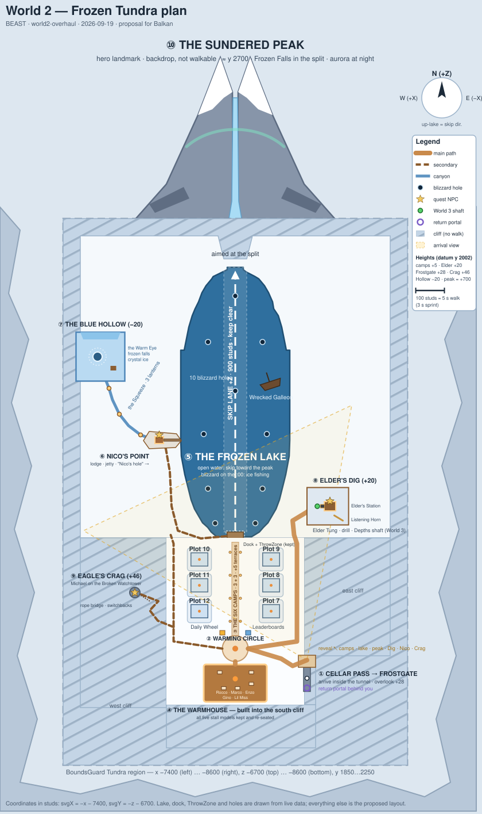

# World 2 — Frozen Tundra Masterplan

**For:** Balkan (approval) · **By:** BEAST · **Branch:** `world2-overhaul` · **Date:** 2026-09-19
**Status:** PLAN ONLY. Nothing has been built, moved, saved or published. The rebuild starts after Balkan approves.
**Built on:** a read-only audit of live Studio (place `78783087742939`). Exact quest findings: `docs/WORLD2-QUEST-AUDIT.md`. Map: [`docs/world2-topdown.svg`](world2-topdown.svg).

**Orientation used everywhere in this plan.** The map is drawn the way a player sees it standing on the dock looking up the lake.
**North = +Z** (up-lake, the skip direction) · **South = −Z** · **East = −X** (right-hand side, toward x −8600) · **West = +X** (left-hand side, toward x −7400).
Heights are studs above the lake/town datum **y 2002** unless written as absolute Y.

---

## TL;DR

- **Keep the lake, the skip lane and the dock exactly where they are.** They are the anchor. Skipping and the hourly Ice Fishing freeze keep working with zero config changes.
- **Rebuild everything around them.** Today's World 2 is a flat 810 × 1650 slab floating in empty sky, walled with 1,000+ blocky ice cubes. It becomes a **frozen caldera**: terrain glacier walls, dark basalt, a warm expedition town and a colossal split mountain at the head of the lake.
- **Arrival becomes a reveal.** You leave Elder Tung's cellar tunnel onto a ledge 28 studs above the basin and see the town, the lake, both shores and the peak in one frame.
- **Six equal camps** line one lantern-lit avenue from the market hall to the dock, 3 + 3, mirror-symmetric.
- **One market hall (the Warmhouse)** built into the south cliff holds all five merchants (the finished stall models are kept and re-seated).
- **Every quest gets its own place:** Elder Tung's Dig on the east shore (main story + the World 3 shaft), Michael's Eagle's Crag high on the west wall, Nico's Point on the west shore, and the Blue Hollow hidden behind it.
- **Hero landmark: the Sundered Peak** — a split mountain with a frozen waterfall, placed so every skip flies straight at the split.
- **Budget:** fewer parts than today (≤ 5,000 vs 6,317), far fewer shadows, lights and Neon — terrain carries the scale.

---

## Brief §41 checklist

| Item | Where |
|---|---|
| A. Top-down diagram | the map above, §2 |
| B. Arrival location | §3 — Cellar Pass / Frostgate, (−8250, 2032, −8300) |
| C. Six plot positions | §4 table |
| D. Merchant hub | §5 — the Warmhouse |
| E. Frozen lake | §6 |
| F. Rock-skipping direction | §7 — +Z, unchanged, aimed at the Sundered Peak |
| G. Nico's lodge | §9 — Nico's Point |
| H. Hidden fishing basin | §10 — the Blue Hollow |
| I. Elder Tung area | §11 — Elder's Dig |
| J. Eagle quest area | §12 — Eagle's Crag |
| K. World 3 progression | §13 — the Depths shaft at Elder's Dig |
| L. Hero landmark | §14 — the Sundered Peak |
| M. Major paths | §16 |
| N. Elevation changes | §2 elevation table |

---

## 1. Design thesis

> **World 2 is an expedition into a frozen caldera.** You climb out of Elder Tung's cellar onto a ledge and the whole basin opens below you: a warm, lantern-lit expedition town at the foot of a long frozen lake that runs straight at a colossal split mountain. Cold, vertical and dangerous-looking at the edges; warm, lit and safe at the centre. Every stone you skip flies at the Sundered Peak — and under the ice, something has been listening back.

What makes it a step up from the Forest:

| World 1 (Forest) | World 2 (Frozen Tundra) |
|---|---|
| Open, colourful, flat meadow | Enclosed caldera, vertical walls, long sightline |
| Cosy campground | Expedition outpost against the elements |
| Everything within a short walk | Districts with their own identity, reached along the shores and up the cliffs |
| Warm everywhere | Cold wash outside, warm pools of light inside — contrast is the palette |

**Visual language — a deliberate short list** (not every idea at once):

1. **Blue glacier walls** — big layered silhouettes, never cubes. The enclosure.
2. **Dark basalt** — bands through the cliffs, foundations, the peak. Gives the white world a value structure.
3. **Chunky snow** — rounded terrain drifts and banks.
4. **Expedition timber + warm lanterns** — the town, the lodges, the piers, one rope bridge.
5. **Frozen waterfalls** — the Frozen Falls in the peak's split, one more in the Blue Hollow.
6. **Aurora** — subtle, night only, over the peak.
7. **Ancient carved stone** — *only* at Elder's Dig, the one hint of the cave "older than the ice".

Deliberately **not** used: crystal forests (crystal appears only in the Blue Hollow), cave networks, rope bridges everywhere, ruins everywhere, sci-fi glow. The one green thing in World 2 is the Lush Gardens shaft — a deliberate "next world" signal.

**Palette:** glacier blues, snow whites with a blue shade ramp, basalt near-black, timber browns, lantern warm (255, 214, 150), brass (198, 148, 62). Warm colours are the only ones that survive the tundra's blue grade, so they mark every place that matters.

---

## 2. District layout

| # | District | Purpose | Centre (x, y, z) | Height vs datum | Side |
|---|---|---|---|---|---|
| 1 | **Cellar Pass + Frostgate Overlook** | arrival reveal; the way home | (−8250, 2030, −8250) | +28 | SE corner |
| 2 | **Frostwatch** — Warming Circle + Avenue | town square, spine to the lake | (−8000, 2003, −8195) | 0 | centre-south |
| 3 | **The Six Camps** | plots 7–12 | Avenue, z −8065 … −7885 | +5 terraces | both sides of the Avenue |
| 4 | **The Warmhouse** | all five merchants | (−8000, 2004, −8315) | 0 (built into the south cliff) | south |
| 5 | **The Frozen Lake** | skipping + blizzard fishing | water x −8190…−7810, z −7806…−6869 | 0 | centre |
| 6 | **Nico's Point** | Nico the Angler | (−7735, 2004, −7470) | 0 | west shore |
| 7 | **The Blue Hollow** | hidden fishing basin | (−7530, 1982, −7180) | −20 | behind Nico, west |
| 8 | **Elder's Dig** | Elder Tung + the World 3 shaft | (−8320, 2022, −7700) | +20 shelf | east shore |
| 9 | **Eagle's Crag** | Michael | summit (−7650, 2048, −8000) | +46 | west wall above town |
| 10 | **The Sundered Peak** | hero landmark (backdrop, not walkable) | (−8000, ≈2700, −6400) | to +700 | north, beyond bounds |
| 11 | **Caldera rim** | the enclosure; kills the "slab in the void" | ring outside the bounds | +80 … +900 | all sides |

**Elevation table (brief item N)**

| Level | Absolute Y | What stands there |
|---|---|---|
| Hollow floor | 1982 | Blue Hollow basin |
| Datum | 2002 | lake surface area, dock, Circle, Avenue, Warmhouse, Nico's Point |
| Camp terraces | 2007 | plots 7–12 |
| Elder's shelf | 2022 | Elder's Station, drill, shaft |
| Frostgate | 2030 | arrival tunnel + overlook |
| Eagle's Crag summit | 2048 (tower top ≈ 2074) | Michael's perch, best panorama |
| Near cliffs (not walkable) | 2080 – 2150 | caldera walls |
| Mid ridges / far peaks (outside bounds) | 2200 – 2900 | rim, Sundered Peak |
| **Hard limits** | 1850 floor · 2250 ceiling | BoundsGuard: below 1850 or above 2250 the player is sent back to the **valley** spawn |

---

## 3. Arrival — the Cellar Pass and the Frostgate

**Today:** players appear at (−8000, 2006, −7975) on a flat plaza facing two plot signboards and a "SKIP HERE" sign; the hub dome is behind them and the world's edge is a wall of ice cubes.

**Plan:**

1. **The Cellar Pass.** You arrive *inside* a short timber-braced ice tunnel in the south-east cliff, at **(−8250, 2032, −8300)**, facing north-north-west (look ≈ (0.42, 0, 0.91)). It is the far end of Elder Tung's cellar — the way you came is literally behind you.
2. **The way home is behind you.** `TundraReturnPortal` moves into the back of the tunnel (turn around and it is there). "The way home is the way you came" needs no signage.
3. **The Frostgate.** Twelve steps forward you walk out onto a ledge **28 studs above the basin**, framed by a timber lantern gate. The view (≈ 70° field) contains, in one frame:
   - the camps and the Avenue below (left),
   - the dock and the whole lake (centre-left),
   - the **Sundered Peak** at the far end of the lake (centre),
   - the lantern-lit **Elder's Dig** shelf on the east shore (centre-right),
   - smoke from **Nico's Point** on the far west shore (left),
   - the **Eagle's Crag** tower on the west wall (far left).
   The Warmhouse is just out of frame to the left and comes into view as you descend.
4. **The Switchback.** A wide, gentle ramp (≈ 7°, two landings) runs down along the south cliff to the Warming Circle's east gate. You walk *toward* the Warmhouse's warm windows — the sequence is **reveal (cold, vast) → descend toward warmth**.

**Why the south-east corner:** it is the one spot where the town, the lake axis, both shores and the peak all fall inside one view, and the descent leads straight to the hub.

**Code touched (after approval):** `TeleportService.TUNDRA_POS` + the Tundra arrival look; `IceFishingEvent.TUNDRA_ARRIVAL` (thaw fallback). World 3's return portal and fast travel both land on `TUNDRA_POS`, so they follow automatically.

---

## 4. Plots — the Six Camps

Plots 7–12 stay the same models (Platform, 16 pads, Campfire, PlotBoard, CampDressing, TundraCamp). They are **moved and turned**, not rebuilt.

**Layout:** a 3 + 3 split along the **Avenue** (x −8000), mirror-symmetric, each camp on a low terrace (+5) with its entrance, PlotBoard and lantern gate facing the Avenue.

| Plot | New pivot (x, y, z) | Entrance faces | Mirror of | To Circle | To dock |
|---|---|---|---|---|---|
| 7 | (−8125, 2007, −8065) | west (onto the Avenue) | 12 | ≈ 130 | ≈ 245 |
| 8 | (−8125, 2007, −7975) | west | 11 | ≈ 220 | ≈ 155 |
| 9 | (−8125, 2007, −7885) | west | 10 | ≈ 310 | ≈ 70 |
| 10 | (−7875, 2007, −7885) | east | 9 | ≈ 310 | ≈ 70 |
| 11 | (−7875, 2007, −7975) | east | 8 | ≈ 220 | ≈ 155 |
| 12 | (−7875, 2007, −8065) | east | 7 | ≈ 130 | ≈ 245 |

**Fairness:** every camp has the same frontage, the same size, the same view up the lake and the same walk to *one* of the two core destinations. Camps nearer the hall are farther from the dock and vice versa (the sum is constant). The Plot / Shops / Skip buttons already teleport, so no camp is disadvantaged in the core loop.

**Camp identity (dressing only):** each camp keeps its tent, hearth, lantern and spires, plus a small expedition flag in one of six colours so players can say "I'm the orange camp". Terraces are backed by the town's east and west walls, which gives each camp a sheltered back and an open front.

**Kept behaviours to re-verify after moving:** claim-by-touch on `Platform`; `World` is stamped from the pivot at server start (must stay inside the Tundra region); the Equip-Best pad is placed by `PlotEquipPad` from each PlotBoard (needs solid ground 31–34 studs out); `TeleportService` Plot/OpenPlot land at pivot + (0, 6, −22)/(0, 6, −14) in **world** axes, which on a turned camp lands near the platform edge (fine; switch to plot-relative offsets only if a landing clips a wall).

**Alternative for Balkan (Option B):** a horseshoe of six camps around the Warming Circle (equal distance to the Circle, unequal to the dock). The Avenue is recommended because it gives the town a spine that points at the lake and the peak.

---

## 5. Merchant hub — the Warmhouse

**Today:** a translucent ice dome (2,333 parts, roof at y 2068) in the middle of everything, blocking the view, containing five finished stalls.

**Plan:** **the Warmhouse**, an expedition market hall **built into the south cliff** on the town's axis, facing north up the Avenue:

- Footprint ≈ 220 × 130 (x −8110…−7890, z −8380…−8250), floor y 2004, roof under y 2046 so it never blocks the Frostgate view.
- Stone base, heavy timber frame, snow-loaded roof merging into the cliff, two chimneys, big warm windows onto the Warming Circle. **Warm inside, cold outside** — the strongest contrast in World 2.
- **The five finished stall models are kept** and re-seated in their current ring (one rigid translation, Δz ≈ −215):

| Stall model | Merchant | Prompt model |
|---|---|---|
| Stone Cache | Rocco the Rock Dealer | `TundraShopStall` |
| Frozen Haul | Marco the Buyer | `TundraSellStall` |
| Thaw Works | Enzo the Upgrader | `TundraUpgradeStall` |
| Frost Eggs | Gino / "Frozen Tundra Eggs" | `TundraEggStall` |
| Rime Charms | Lil Miss (shop marked Coming Soon) | `TundraCharmStall` |

- A central hearth replaces the dome's dais; the dome's barrels, crates, hide bales, rugs, bear statue and sconces are reused as dressing.
- Not "four stalls in a row": a U of counters around the hearth, with Rocco and Marco on the back wall, Enzo and Lil Miss on one side, Gino and his egg nests on the other.

**Code touched:** `TeleportService.NAV.Tundra.Shops` (Shops button). Stall prompts are bound **by model name** (`ClientMain`, `EggShopClient`, `EggHandler`, `MerchantConfig.AltStalls`) and the keepers' idle motion by stall name (`NpcBodyLife`, `NpcPropLife`) — names are kept, so nothing else changes.

---

## 6. The Frozen Lake

**Kept exactly:** the terrain-water body (a lens, 380 studs wide at the middle, pinching to ≈ 60 at the dock, z −7806 → −6869), the invisible `LakeBarrier` ring (164 walls), the dock footprint, the `ThrowZone`. These are what `IceFishingConfig.LAKE_PROFILE`, its dock-flank strips and `IceFishingEvent`'s hard-coded dock-lane numbers are measured against — moving any of them means re-measuring the fishing rig.

**Changed:** everything around it.

- **Shores:** low terrain snow banks at the waterline, a shore path on each side 20–60 studs back, then glacier cliffs stepping up in two tiers to y 2080–2150 with dark basalt bands.
- **Bergs:** the 240 floe parts go — including the **21 parts that sit inside the skip lane today** (a stone flies through them). At most 8 large hero bergs remain, frozen in near the shores, never within 40 studs of the lane.
- **Story props kept:** the Wrecked Galleon (east part of the lake, outside the lane) — reachable on foot only during a blizzard; the IceBuoy.
- **North end:** the lake runs straight into the Frozen Falls of the Sundered Peak (§14).

**One lake, two uses** (brief §13) — this is already true in the systems and the plan makes it visible: in normal weather it is open water you skip across toward the peak; every real-clock hour the blizzard freezes it into a fishing field with ten lantern-marked holes, and the shores (Nico's Point, the dock, the galleon) become the ways onto the ice.

---

## 7. Rock skipping

**Unchanged mechanics and positions:** `FrozenTundra.SkipArea.ThrowZone` at (−8000, 2006, −7803), 64 × 26 × 34, `SurfaceY = 2000`, `SkipStartZ = −7788`, direction +Z (default). `ThrowHandler` caps a throw at 900 studs, so a max throw ends near z −6888 — inside the lake's north end (−6869).

**What the environment adds:**

- **A clear lane:** x −8040 … −7960 from z −7788 to −6869 stays free of anything taller than the water (today 21 floe parts violate it).
- **A horizon with a target:** the lane points exactly at the split of the Sundered Peak. The dock's "SKIP HERE" sign frames it. Long throws read as "almost reaching the Falls".
- **Readable catches:** no bergs, low mist or props near the lane, so the catch reveal (`CatchCinematic` cuts, anchored at the landing point) plays over clean water.
- **Camera:** the throw camera looks up the lake; the side walls are kept at least 190 studs from the lane so they frame without crowding.
- **Rarity bands (`RarityConfigTundra`):** C 0–110, U 110–220, R 220–340, E 340–460, L 460–580, M 580–700, S 700–820, G 820–900. Optional later (not in this phase): subtle shore markers at the band distances, like the valley's retired buoys.

---

## 8. Ice Fishing

**Kept exactly:** `IceFishingEvent` / `IceFishingConfig` / `IceFishingClient` / `RodService` — the real-clock blizzard on the :00, 20-minute freeze, CSG ice sheet over the lake profile, 10 holes, charge + perfect band, multi-step reel, real grant from the 23 exclusives, rod replacing the satchel, throwing off while frozen, thaw teleport.

**What the environment adds:**

- **Shore access points:** the barrier drops everywhere during a freeze, so the dock, **Nico's jetty** and the east shore by the galleon all become ways onto the ice. Nico's jetty sits ≈ 80 studs from the hole at offset (+110, −110) — "Nico's hole".
- **A reason to go there:** Nico's lodge is where the blizzard *means* something (dialogue, trophies, the questline).
- **The Blue Hollow** (§10) as the fishing endgame place.

**Not changed in this phase:** the rig's own dressing budget (it adds ≈ 1,900 parts while frozen). A later, optional pass can thin it now that the new shores frame the lake.

**Gap to know about (audit §3.2):** a landed fish currently notifies nothing (no quest, season pass, emerald or daily-quest hook). Nico needs one hook in the grant path.

---

## 9. Nico the Angler — Nico's Point

Full questline, personality and implementation shape: **`WORLD2-QUEST-AUDIT.md` §3**. Summary:

- **Place:** a rocky point on the **west shore** at (−7735, 2004, −7470), reached from the dock by the West Shore Path (≈ 420 studs).
- **The lodge:** small, warm and heated (≈ 30 × 24): stove chimney smoking, fish trophies on the wall, a "BIGGEST CATCHES" board where every entry reads "got away", warning signs ("THIN ICE — NICO SAYS IT'S FINE"), a rod rack, an auger, lanterns, a short jetty to the waterline. **Cosy against a huge frozen lake** — the district's whole identity.
- **Quests (for approval):** 1 **First Bite** (land 3 fish) · 2 **What's Under There?** (5 different species) · 3 **The Deep Hole** (follow his lanterns to the Blue Hollow) · 4 **The One That Got Away** (land a Secret fish). Rewards are Balkan's call.
- **Not** the drill, **not** salvage, **not** World 3, **not** main story.

---

## 10. The hidden fishing area — the Blue Hollow

**Part of World 2.** Not beyond any portal, and not a World 3 entrance.

**The route (compression → release):**

1. Behind Nico's lodge a gap in the boulders opens into **the Squeeze**, a narrow glacier canyon (8–12 wide, walls 40–70 tall), winding ≈ 200 studs west then north and gently descending.
2. Three of Nico's **old lanterns** hang along it (Quest 3: light them). Dim and blue between them, warm at each one.
3. The canyon passes under a low **ice arch**…
4. …and opens into **the Blue Hollow**: a secluded basin (≈ 170 × 170) at y 1982, 20 studs below the lake, enclosed by a towering overhanging blue glacier face, with a frozen waterfall, the only crystal ice in World 2, Nico's abandoned shanty with his note, and a small frozen pond with **one steaming hole — the Warm Eye** — kept open by a warm spring.

**Target reaction:** "Whoa, I didn't know this was back here" — not "I walked 800 studs through nothing". Total walk from Nico ≈ 280 studs (≈ 13 s), all of it tight canyon until the reveal.

**Location:** centre (−7530, 1982, −7180); walkable floor inside x −7615…−7445 (≥ 45 studs inside the region's west bound); walls may continue outside the bounds.

**Gameplay (needs Balkan's decision — audit §3.6):** the Warm Eye can be a **permanent fishing hole** that works outside the blizzard for players who finished Nico's Quest 3. That fixes "you can only fish 20 minutes an hour" for the endgame and gives the Hollow a real purpose. It needs an `IceFishingEvent` extension (a persistent hole gated by a player flag). If rejected, the Hollow is still a lore/exploration reward.

---

## 11. Elder Tung — Elder's Dig

**Today:** a small dark cabin on a thin spit on the east shore; the drill site is an invisible part beside it.

**Plan:** **Elder's Dig**, a raised glacier shelf on the **east shore** at y 2022, centre (−8320, 2022, −7700), reached by the East Road and a ramp.

- **Elder's Station:** his lodge rebuilt bigger and older than the valley hut — stone base, timber upper, a big chimney, warm windows, a porch facing the lake where he sits (prompt `TungCavePrompt`). It should read as the most important building outside the town.
- **The Listening Horn:** a huge brass ear-trumpet angled down into a faint blue crack in the ice shelf — "I have listened to it for forty years." Behind the lodge, a slab of **ancient carved stone** shows through the glacier: the one hint of the cave "older than the ice".
- **The drill pad:** `DrillSite` on the shelf between the lodge and the shelf edge, 26 studs from the lodge, looking at the lodge. The client-drawn rig appears there in stages (salvage → built → running), and the **Depths shaft** opens 12 studs toward the lake. The ≈ 30 studs over the shelf edge on the lake side stay open for the two cutscene cameras.
- **Seen from everywhere:** from the dock (≈ 330 studs across the water) you see warm windows, chimney smoke and — once built — the derrick silhouette. The main story is visible for the whole grind.

**Kept exactly:** the quest logic and its co-location contract — `ElderTungTundra` (+ prompt), `DrillSite` (a direct child of `FrozenTundra`) and `Portals.DepthsPortal` move **together** as one rigid transform, and `DepthsPortal`'s `RefuseX/Y/Z` move with them.

---

## 12. Eagle quest — Eagle's Crag

**Today:** Michael sits on a rubble pile in a dead-end corner behind the dome.

**Plan:** **Eagle's Crag**, high on the **west wall** above the town — the one place that uses World 2's verticality for a quest giver.

- Trailhead on the West Road behind the west camps; switchback ledges up the cliff; **one rope bridge** over a crevasse; a summit ledge at y 2048 (+46).
- The existing **Broken Watchtower** (115 parts) is moved up to the summit; Michael perches on its broken top among a messy nest of "borrowed" things (scarves, a lantern, a golden spoon) and a telescope aimed at the camps. Shady bird, shady roost.
- The summit is **the best panorama in World 2**: town, lake, both shores, the Hollow's ice wall glimpsed over the ridge, and the peak.
- Tower top ≈ 2074 stays below `TundraBirds`' flight band (2080–2120).

**Kept exactly:** `FrozenTundra.Michel` stays at that path (`NpcIdle` finds him by path), prompt name `MichelPrompt`, all quest logic. Only the model's pivot moves.

**Different from Tung and Nico:** Tung = skip mastery down by the water; Nico = fishing on the ice; Michael = a climb to a secret trade.

---

## 13. World 3 progression area

**Live today:** World 3 (the Lush Gardens) is built but held back (`WorldTravelConfig` Gardens `ComingSoon = true`). Its only entrance is the **Depths shaft** that Elder Tung's drill opens (`DepthsPortal`, `RequiresFlag = "CaveUnlocked"`). World 3's return portal lands players back at the Tundra arrival.

**Plan:** keep exactly that and make it look like the end of a chapter — **Elder's Dig is the World 3 district.** The shaft is the only green light in World 2 (the Gardens' own palette), visible from the shelf edge once the drill runs. The hidden basin, Nico and the Eagle stay entirely separate from it.

No new World 3 gateway is needed or proposed.

---

## 14. Hero landmark — the Sundered Peak

A colossal mountain **split in two**, standing beyond the north end of the lake (outside the walkable bounds), centred on the skip lane's axis (x −8000):

- Two leaning glacier-capped halves rising to ≈ y 2700 (700 studs above the lake) with dark basalt faces, so the silhouette survives the tundra haze.
- The **Frozen Falls** fill the lower split and spill into the head of the lake.
- A faint **aurora** ribbon over the split at night (two or three Beams, client-side, driven by the existing `Lighting` `Daylight` attribute).

**Why this landmark:** it orients the whole world (you always know which way is up-lake), it is the target of the core loop (every throw flies at it), and it foreshadows the story (a mountain cracked open by whatever is under the ice). It is built from a handful of huge shapes plus terrain — cheap.

---

## 15. Terrain strategy

**Today:** the north half is terrain (snow + water), the south half is three big collidable part slabs (`Ground`: `IceShelf`, `ShelfDeep`, `DeepBaseDeep`), and the edges are 1,000+ Glacier-material cubes (`Icebergs`) plus `ShelfEdge` and `Relief`. From outside it is a floating rectangle.

**Plan:** terrain carries the world.

| Layer | Material | Notes |
|---|---|---|
| Town floor, shores, paths' base | Snow + Ice (packed paths via darker snow / timber boardwalks) | replaces the `Ground` slabs; `SnowFootprints` already reads terrain Snow |
| Glacier walls and cliffs | Glacier with Basalt/Slate bands | 2 tiers, rounded tops, no cubes |
| Caldera rim | Snow / Glacier / Rock | 2–3 ridges outside the bounds for depth |
| Sundered Peak | Rock + Glacier + Snow, plus a few big parts for the split faces | backdrop |
| Lake | existing terrain Water | untouched |

**Rules:**

- Every walkable surface stays inside the BoundsGuard box with ≥ 30 studs of margin. **Edges are sealed by terrain cliffs** — no drop-offs, because a fall below y 1850 sends a player back to World 1 (there is no Tundra spawn).
- Terrain around the lake keeps the existing water outline; after sculpting, a forced freeze (`ReplicatedStorage.IceFishingForce`) re-checks that the ice sheet still meets the shore.
- Build in a **staging copy** first (see §20 #11); the old part-ground stays until the swap, so the live world never has a hole in it.

---

## 16. Path strategy

**Main paths** (16–24 studs wide, packed snow + timber boardwalk, lantern posts, obvious):

1. Cellar Pass → Frostgate → Switchback → Warming Circle.
2. Warming Circle ↔ Warmhouse (on the axis).
3. Warming Circle → the Avenue → Dock.
4. Warming Circle → East Road → Elder's Dig (the main story is on a main path).

**Secondary paths** (8–12 wide, fewer lanterns, more exploratory):

5. Dock → West Shore Path → Nico's Point.
6. Nico's Point → the Squeeze → the Blue Hollow (narrowest, lantern-marked).
7. West Road → crag switchbacks → rope bridge → Eagle's Crag.
8. Frostgate High Ledge → a hidden overlook on the east cliff (optional secret, blockout-tested).

**Ice routes** (only while frozen): any shore → the holes; → the Wrecked Galleon.

**Wayfinding without giant arrows:** warm light marks destinations (the Warmhouse windows, Elder's chimney, Nico's stove, the Eagle's tower lantern); the Avenue points at the lake and the lake points at the peak; one signpost on the Warming Circle names the four directions.

---

## 17. Lighting

- **Keep** the tundra grade (`TundraAtmosphere`: exposure −0.70 × daylight, `TundraGrade` contrast/saturation, cold haze Density 0.26 / Haze 1.9). Re-tune only after the terrain is in (the peak must read through the haze).
- **Cold outside, warm inside** is the palette: warm pools at the Warmhouse, Elder's Station, Nico's lodge, each camp's fire and the Avenue lanterns; cool blue light in the Squeeze and the Blue Hollow; one green light (the shaft).
- **Bloom is on** (`Lighting.Bloom` 0.45, threshold 1.05), so glowing lamp parts are **SmoothPlastic + PointLight**, not Neon (the rule from the valley lighting pass).
- **Budget:** ≤ 60 PointLights in the whole Tundra (88 today), all `Shadows = false`, ranges ≤ 18.
- **Accents:** camera-following snow (existing `TundraWeatherFX`), low mist only at the lake's far end, aurora at night. Controlled, never constant everywhere.
- **Fix in passing:** `TundraWeatherFX` and `SnowFootprints` stop at z −7400 while the world runs to −6700 — no snowfall or footprints over the north half of the lake today.

---

## 18. Performance

**Measured today** (`FrozenTundra`, at rest): 6,317 BaseParts · 5,676 shadow casters · 88 lights · 220 Neon · 197 semi-transparent · 16 emitters · 141 MeshParts. The blizzard rig adds ≈ 1,900 parts while frozen.

**Targets for the rebuilt Tundra (excluding plot contents and brainrots):**

| Metric | Today | Target |
|---|---|---|
| BaseParts | 6,317 | **≤ 5,000** |
| CastShadow on | 5,676 | ≤ 800 (big architecture only) |
| PointLights | 88 | ≤ 60, shadows off |
| Neon parts | 220 | ≤ 40 |
| Semi-transparent parts | 197 | ≤ 60 |
| Always-on emitters | 16 | ≤ 25 |

**How:** terrain for ground, cliffs, rim and peak; a small set of reusable rock/ice meshes (≤ 12 unique); big silhouettes over many small pieces; `CastShadow = false`, `CanQuery = false` and `CanTouch = false` on dressing; NPC and stall models streamed atomically; nothing animated server-side that the client can do.

**Full-server condition:** 6 camps × 16 brainrots (forge meshes, 2–12 MeshParts each, distance LOD in `BrainrotIdleClient`) + mutation FX (already budgeted) + the blizzard rig + six players' UI. The full-server test in Appendix C measures this on the finished blockout.

---

## 19. Keep / Move / Rebuild / Remove

Everything removed is **backed up to `ServerStorage` first, never deleted.** Part counts are live.

### KEEP (unchanged, in place)

| What | Why |
|---|---|
| Lake water body, `LakeBarrier` (164), `ThrowZone`, dock footprint, IceBuoy | the fishing profile and skip lane are measured against them |
| `Ruins.WreckedGalleon` (103) | story prop, outside the lane, becomes a blizzard-only destination |
| Every script, config and remote | brief rule: preserve gameplay systems |

### MOVE (same object, new pivot)

| What | To | Also update |
|---|---|---|
| `PlayerBases.Plot7`–`Plot12` | the Six Camps (§4), turned to face the Avenue | verify claim, Equip-Best pad, Plot/OpenPlot landing |
| `Hub.Stalls` (5 models, 1,056) + `Tundra{Shop,Sell,Egg,Upgrade,Charm}Stall` prompt models | inside the Warmhouse, one rigid move | `TeleportService.NAV.Tundra.Shops` |
| `ElderTungTundra` + `DrillSite` + `Portals.DepthsPortal` | Elder's Dig, one rigid move | `DepthsPortal` `RefuseX/Y/Z` |
| `FrozenTundra.Michel` | Eagle's Crag summit | keep the path and prompt name |
| `Ruins.BrokenWatchtower` (115) | Eagle's Crag summit | |
| `Portals.TundraReturnPortal` (254) | back of the Cellar Pass tunnel (rebuild smaller if it will not fit) | |
| `DailyWheelTundra`, `LeaderboardsTundra` | the Avenue mouth | `WheelBoard.SITES`, `LeaderboardBoards.TUNDRA_AT/LOOKAT` |
| Some `Village` tents and igloos | camp and town dressing | |
| Tundra `AmbientAudio` emitters | the new districts | |

### REBUILD

| What | Becomes |
|---|---|
| `Ground` (32), `Relief` (410), `ShelfEdge` (305) | terrain floor, shores and caldera rim |
| `Icebergs` (1,003) | terrain glacier cliffs + ≤ 8 hero bergs |
| Hub shell: `Dome` 604, `Interior` 298, `Inlay` 287, `Trim` 34, `Windows` 12, `Lanterns` 8, `Plaza` 16, `Floor` 1, `Entrance` 17 | the Warmhouse (interior props reused) |
| `ElderHut` (113) | Elder's Station (hearth reused) |
| `Village.Trails` (52) | the new path network |
| Dock dressing | restyled expedition pier on the **same footprint and deck height** |

### REMOVE (backed up)

| What | Why |
|---|---|
| All 240 `Floes` except ≤ 8 edge bergs (incl. the 21 in the skip lane) | lane obstruction, visual noise |
| `IceSpikes` (602) | noise; ~6 clusters reused in the Blue Hollow |
| `Ruins.RuinedHamlet` (185), `Ruins.AbandonedOutpost` (44) | replaced by districts with purpose |
| `Village.ArrivalPlaza` (17) | the arrival moves |
| `FrozenTundra.Decor` (4) | review first |

### NEW

Cellar Pass + Frostgate + Switchback · Warming Circle + Avenue + camp terraces · the Warmhouse · Elder's Station + Listening Horn + shelf · Nico's Point · the Squeeze + Blue Hollow · Eagle's Crag path, rope bridge and summit · the Sundered Peak + Frozen Falls · the caldera rim.

---

## 20. Dependency risks

| # | Risk | Mitigation |
|---|---|---|
| 1 | **BoundsGuard** region (x −8600…−7400, y 1850…2250, z −8600…−6700) defines `PlayerWorld()` for plots, throws, quests and fishing; outside it, or below y 1850, the player is sent to the **valley** spawn. | Design inside it with ≥ 30 studs margin; seal edges with terrain; no drops. `BoundsGuard` itself is not changed. |
| 2 | Only one `SpawnLocation` exists (valley): dying or resetting in World 2 sends you to World 1. | Out of scope (the separate-place era needs a Tundra spawn). The design has no lethal hazards. |
| 3 | `IceFishingConfig.LAKE_PROFILE` (24 bands), dock-flank strips, `LAKE_CENTER`, `HOLES`, and `IceFishingEvent`'s hard-coded dock lane (z −7745 / −7787 / −7765) are tied to the water outline and dock faces. | Water outline and dock footprint are **not** changed. Re-verify with a forced freeze after terrain work. |
| 4 | Skip lane / catch reveals need clear water. | Nothing within x −8040…−7960 from z −7788 to −6869. |
| 5 | **Name/path contracts:** `FrozenTundra.Michel` (NpcIdle), `MichelPrompt`, `TungCavePrompt` (must be under `FrozenTundra`), `FrozenTundra.DrillSite` (direct child), `SkipArea`/`LakeBarrier`/`IceFishing` folder names, `Tundra*Stall` + `PromptPart` + prompt names, `Hub.Stalls` model names (NpcBodyLife/PropLife), `Portals.*.PortalTouch` attributes. | Move objects, never rename them. New prompts live under `GameWorld.FrozenTundra`. |
| 6 | Drill cutscenes need `DrillSite` streamed in right after the talk. | Prompt, site and shaft move together; ≥ 30 studs clear on the site's lake side. |
| 7 | `WheelBoard` and `LeaderboardBoards` rebuild at coded coordinates on a LayoutVersion bump. | Update their constants in the same change as the move. |
| 8 | `PlotEquipPad` derives the Equip-Best pad from each PlotBoard. | Verify all six after moving. |
| 9 | Plot `World` is stamped at server start from the pivot. | All camps inside the Tundra region. |
| 10 | StreamingEnabled: prompts are bound via `DescendantAdded`; parts 8,000 studs away do not exist on the client. | Keep the pattern; NPC and stall models atomic. |
| 11 | **Team Create:** Duck edits World 1 in the same place, and any publish ships whatever World 2 state exists at that moment. | Build the blockout in a **staging folder** beside the live Tundra, swap in one operation, agree a publish freeze for the swap window. BEAST never saves or publishes — that is Balkan's call. |
| 12 | Blizzard rig (+ ≈ 1,900 parts) on top of the new world. | Measure in the full-server test; thinning the rig is a later option. |
| 13 | Bloom is on: Neon blows out. | Lamps are SmoothPlastic + PointLight. |
| 14 | The repo mirror is partial and stale for World 2. | Mirror every touched script byte-exact in the same commit. |
| 15 | `TundraBirds` fly at y 2080–2120. | Crag tower top ≤ 2075. |
| 16 | Nico needs a hook inside the fishing grant path (a critical path). | One `pcall`-guarded call, after approval only. |

**Scripts that change during implementation (all small, all backed up first):** `TeleportService` (`TUNDRA_POS` + arrival look, `NAV.Tundra.Shops`), `IceFishingEvent` (`TUNDRA_ARRIVAL`), `WheelBoard.SITES`, `LeaderboardBoards` (`TUNDRA_AT/LOOKAT`), `TundraWeatherFX` + `SnowFootprints` (region to −6700), and the `DepthsPortal` attributes. **Not touched:** `BoundsGuard`, `PlayerDataManager`, `SessionLock`, DataStore, place IDs, quest logic, `IceFishingConfig`.

---

## Appendix A — World 2 inventory (live, 2026-09-19)

- **FrozenTundra** (6,317 parts): `Ground` 32 · `Decor` 4 · `Icebergs` 1,003 · `Hub` 2,333 (Stalls 1,056, Dome 604, Interior 298, Inlay 287, Trim 34, Entrance 17, Plaza 16, Windows 12, Lanterns 8, Floor 1) · `Village` 461 · `Relief` 410 · `Floes` 240 · `ShelfEdge` 305 · `SkipArea` 243 · `Ruins` 447 · `IceSpikes` 602 · `ElderHut` 113 · `Michel` 57 · `ElderTungTundra` 66 · `DrillSite` 1.
- **Other Tundra objects in `GameWorld`:** `Tundra{Shop,Sell,Egg,Upgrade,Charm}Stall` (1 part each), `DailyWheelTundra` (77), `LeaderboardsTundra` (18), `Portals.TundraReturnPortal` (254), `Portals.DepthsPortal` (1).
- **Plots 7–12:** 105 parts each; `Platform` 46 × 1.3 × 59 (Ice); 16 pads in two rings around the campfire; attributes `World, Claimed, OwnerUserId, OwnerName, PlotIndex, PlotLikes, TotalEarned`. Pads carry `__origCF/__origSize` leftovers that nothing reads.
- **Scripts that know World 2 exists:** `TundraQuest`, `MichelQuest`, `DevQuest`, `IceFishingEvent`, `RodService`, `TeleportService`, `BoundsGuard`, `WorldProgression`, `WorldTravelConfig`, `LeaderboardBoards`, `WheelBoard`, `NpcIdle`, `NpcBodyLife`, `NpcPropLife`, `SnowFootprints` (server); `TundraQuestClient`, `MichelQuestClient`, `CaveDrillClient`, `IceFishingClient`, `RodFxClient`, `TundraAtmosphere`, `TundraWeatherFX`, `TundraBirds`, `QuestTrackerClient`, `ClientMain`, `EggShopClient` (client).
- **Movement:** walk 20.8 studs/s, sprint 33.8 (`ClientMain`). The VIP scooter is inert until gamepass IDs exist.
- **Lighting:** Brightness 2.42, ClockTime 14, Bloom 0.45 / 1.05, global Atmosphere Density 0.16 (the tundra raises it to 0.26 / Haze 1.9 client-side).

## Appendix B — Route targets (brief §43)

Walk 20.8 / sprint 33.8 studs/s. Path lengths are plan estimates; the blockout measures them for real with a timed walk.

| Route | Today (straight line) | Plan (path) | Walk | Sprint |
|---|---|---|---|---|
| arrival → nearest camp | ≈ 80 | ≈ 230 | 11 s | 7 s |
| arrival → farthest camp | ≈ 215 | ≈ 430 | 21 s | 13 s |
| camp → dock | 130 – 300 | 70 – 260 | 3 – 13 s | 2 – 8 s |
| camp → Warmhouse | 200 – 300 | 130 – 310 | 6 – 15 s | 4 – 9 s |
| dock → Nico | — | ≈ 420 | 20 s | 12 s |
| Nico → Blue Hollow | — | ≈ 280 | 13 s | 8 s |
| arrival → Elder Tung | ≈ 290 | ≈ 560 | 27 s | 17 s |
| arrival → Eagle's Crag | ≈ 280 | ≈ 620 | 30 s | 18 s |
| Elder Tung → World 3 shaft | ≈ 30 | ≈ 30 | 1.5 s | 1 s |

The arrival pays ≈ 200 studs for the reveal. If a route feels boring in the blockout, the fix is the world (views, landmarks, shortcuts such as the High Ledge), not player speed.

## Appendix C — Regression tests (brief §44)

| Area | Test | How |
|---|---|---|
| Plots | all six claim; Equip-Best pad appears and works; pads place; income ticks; campfire bank collects; Plot/OpenPlot buttons land on the platform | Play solo per camp; then 6-player local server |
| Skipping | Tundra ThrowZone arms; short (≈ 100), medium (≈ 450), long (≈ 850) throws land on clean water; catch reveal and cinematic cuts play | Play, three power levels; watch the lane |
| Ice Fishing | freeze builds and meets the shore; throwing is off while frozen; FISH HERE shows at all 10 holes; perfect band; reel; exclusive catch lands in the bag; thaw sends people home | `ReplicatedStorage:SetAttribute("IceFishingForce", 120)` |
| Merchants | Rocco (Tundra shelf), Enzo, Marco (sell), Gino (Tundra eggs), Lil Miss (Coming Soon) all open from their new spots; walk-away close works | Play, press E at each |
| Elder Tung | talk → accept; stage jumps; salvage toast; Build + Start cutscenes frame the rig and the lodge; shaft appears; Depths portal refuses with "coming soon" and puts you back on the shelf | `DevQuest` `/tq` verbs |
| Eagle | talk → accept; picker lists mutated Sahurs; partial and final hand-over; reward | `/tq michel` |
| Nico | (once built) all four stages | `/tq nico` (to add) |
| Travel | valley cellar → Tundra arrival; Worlds board fast travel; return portal → valley dungeon; Gardens return → arrival; BoundsGuard never fires anywhere walkable | Play + a walk of the whole perimeter |
| Separate-place compatibility | nothing new depends on the valley being present; `WORLD_PLACE_IDS` untouched | code review of every changed line |
| Performance | part/light/shadow counts vs §18; full-server FPS with six camps of 16 | scripted counts + 6-player local server |

## Appendix D — Blockout plan (brief §42), after approval

1. **Backups.** `ServerStorage.World2Backups_<date>`: a clone of `FrozenTundra`, the `Tundra*` models, the two Tundra portals and plots 7–12; scripts into `ServerStorage.AuditBackups` before any edit.
2. **Staging.** Terrain massing and grey-box districts built beside the live Tundra (a staging folder + a terrain region copy), so the live world is never half-built.
3. **Move systems' objects** into the grey-box and update the listed constants.
4. **Balkan walks it**: scale, travel times, sightlines (the Frostgate frame, the lane-to-peak axis), district separation, camp fairness, quest routes, lake size, verticality, the Blue Hollow reveal.
5. Iterate, then **swap in one operation** in an agreed publish-freeze window.
6. Only then: detail, lighting and FX pass per district.
7. Nico and the Blue Hollow hole: separate, after their own approval.

## Appendix E — Decisions needed from Balkan

1. Approve the district layout (Avenue camps; Option B = horseshoe).
2. Approve the south-east Cellar Pass arrival (moves `TUNDRA_POS`).
3. Replace the ice dome with the Warmhouse (the five stalls are kept).
4. Approve the terrain conversion (part slabs and ice cubes → terrain).
5. Move Michael to Eagle's Crag; move Elder Tung to Elder's Dig.
6. Nico: approve the four-quest structure and set every reward.
7. The Blue Hollow's permanent hole outside the blizzard: yes or no.
8. Should fish feed the season pass / emeralds / daily quests (separate ticket)?
9. Workflow: staging folder + a publish freeze for the swap (coordinate with Duck).

## Appendix F — Roster and content gaps (brief §31–32; documented, **not** rebalanced)

- **Tundra roster (live):** 113 entries — 57 cross-overs (World 1 Epic → Common 22, Legendary → Uncommon 20, Mythic → Rare 15), 30 Tundra originals (Epic 10, Legendary 8, Mythic 6, Secret 4, God 2), 23 Ice Fishing exclusives, 3 Forge pilots. **0 missing models.** Sampled models are all MeshPart-built (the 2026-09-17 forge conversion).
- **Disabled originals:** the three Forge pilots sit at `Weight = 0` (Guantone Brontolone — Epic, Alce Lampadario — Legendary, Nonno Ghiacciaio — Secret) until the owner sets a weight.
- **Thin tiers:** only 2 throwable Gods and 4 Secrets; fishing has no God tier and only 2 Legendary / 2 Mythic fish.
- **No World 2 quest-exclusive brainrot for Elder Tung's arc** (it pays cash, gems and a key). A possible future hook.
- **Michael's reward (Pippo Olivardino)** lives in the Valley roster, so it appears on the Valley Index tab.
- Any new brainrot follows `docs/brainrot-build-standard.md` (pack-profile budgets, no voxel monsters).

## Appendix G — Current-state reference views (captured 2026-09-19)

Captured from live Studio for the audit: overhead (the slab and the ice-cube walls in open sky); oblique from the south-east (the "floating rectangle"); the arrival view (signboards and a "SKIP HERE" sign); the dome entrance; the dock view up the lake (bergs in the lane); Elder Tung's hut on the east spit; Michael on the rubble in the corner. Camera positions are in the session notes if they need to be re-shot for before/after comparisons.
